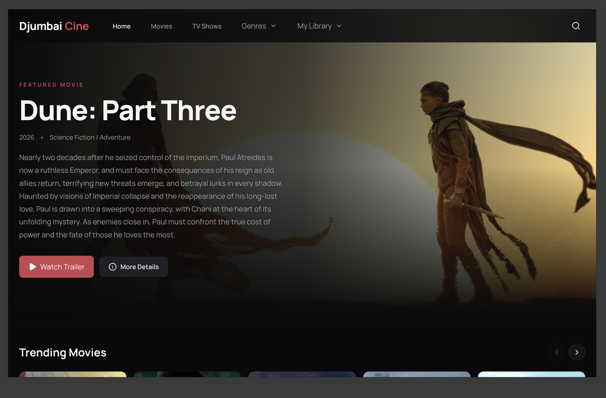
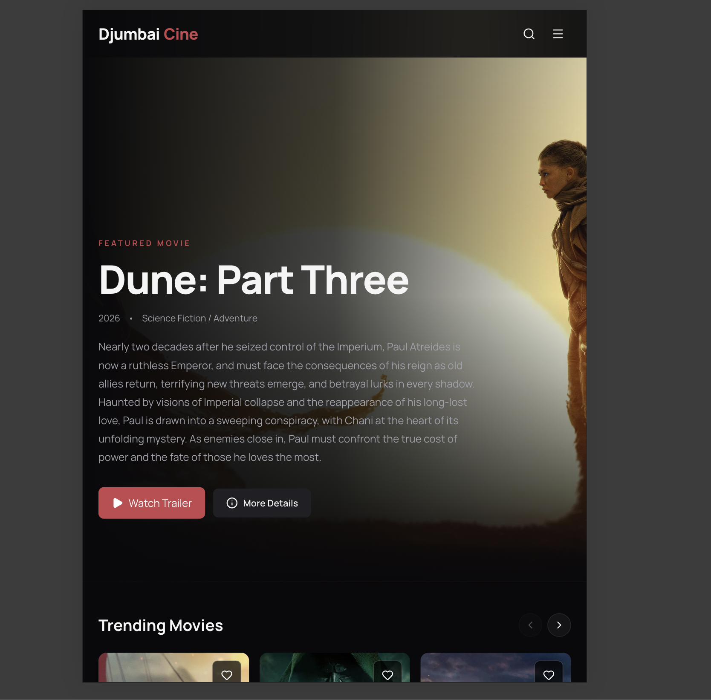
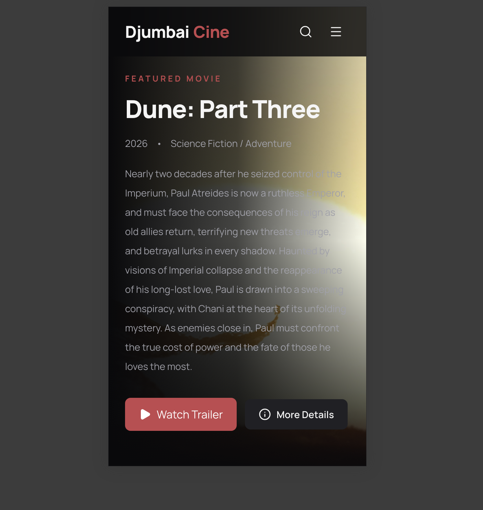

# 🎬 Djumbai Cine

A modern and responsive movie and TV show discovery application built with **React, Vite, and Tailwind CSS**, powered by the [TMDB API](https://www.themoviedb.org/).

Discover movies and TV shows, explore trending titles, watch trailers, and organize your favorites and watchlist.

## 🌐 Live Demo

**[Explore Djumbai Cine](https://djumbai-cine.vercel.app/)**

## 📸 Preview

### Desktop



### Responsive Design

|                          Tablet                          |                          Mobile                          |
| :------------------------------------------------------: | :------------------------------------------------------: |
|  |  |

## ✨ Features

- Discover popular and trending movies and TV shows.
- Search titles with live suggestions.
- Explore content by genre.
- View ratings, cast, trailers, and related titles.
- Save favorites and manage a personal watchlist.
- Keep collections saved using `localStorage`.
- Enjoy a responsive interface across desktop, tablet, and mobile devices.

## 🛠️ Tech Stack

**Frontend:** React 19 · JavaScript (JSX) · Vite 8 · Tailwind CSS 4 · React Router 7

**State & Storage:** Context API · localStorage

**API & Deployment:** TMDB API · Vercel Serverless Functions · Vercel

**Tools:** Git · GitHub Actions · ESLint · Vitest · React Testing Library · Lucide React · React Toastify

## 🚀 Getting Started

Use Node.js 24 or later. Clone the repository and install dependencies:

```bash
git clone https://github.com/arafamdev/djumbai-cine.git
cd djumbai-cine
npm ci
```

Create a `.env.local` file in the project root and add your [TMDB API Read Access Token](https://www.themoviedb.org/settings/api):

```env
TMDB_ACCESS_TOKEN=your_tmdb_read_access_token
```

Start the development server:

```bash
npm run dev
```

**Note:** API credentials are kept outside the frontend code. Production requests are handled through a Vercel serverless proxy.

## Validation

```bash
npm run lint
npm test
npm run build
npm audit
```

`npm run test:watch` runs Vitest in watch mode. Tests cover search interactions and pagination, library persistence and storage failures, media normalization, TMDB services, and the serverless proxy. GitHub Actions runs the same checks on pull requests and pushes to `main`. API tests use mocked responses and require no token.

## 🗺️ Future Improvements

- Advanced filtering and sorting.
- Actor and director profiles.
- Performance and accessibility improvements.

## 🎞️ Attribution

**This product uses the TMDB API but is not endorsed or certified by TMDB.**

Movie and TV metadata are provided by [TMDB](https://www.themoviedb.org/).

## 👨‍💻 Author

**Arafam Silla** — Frontend Developer

[GitHub](https://github.com/arafamdev) · [LinkedIn](https://www.linkedin.com/in/arafam-mussa-silla-5a7866446/)

## 📄 License

No open-source license has been specified for this repository.
